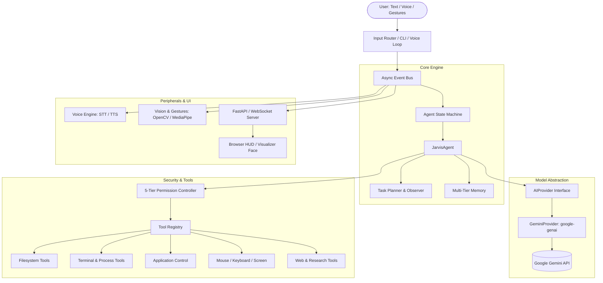

# JARVIS System Architecture Specification

## 1. Architectural Philosophy

JARVIS is designed as an intelligent operating layer over the user's computer. The core guiding architectural principles are:

1. **LLM as the Reasoning Engine, Not the Entire System**: The language model (Google Gemini) provides intelligence, planning, and evaluation. Deterministic software provides state management, permission enforcement, memory indexing, hardware control, and safety boundaries.
2. **Strict Model Abstraction**: The core agent interacts only with an abstract `AIProvider` interface. The primary implementation is `GeminiProvider`, leveraging the official `google-genai` SDK. Future models or local providers can be slotted in without modifying core agent logic.
3. **Decoupled Asynchronous Event-Driven Design**: The Voice system, Vision system, UI Visualizer, and Tool Executors communicate asynchronously via an in-memory `EventBus`. No component blocks the main event loop.
4. **Defense in Depth & 5-Tier Permission Security**: Model-requested tools pass through a deterministic Permission Controller. Destructive operations (Levels 3 & 4) strictly require human confirmation.
5. **Local-First Transparency**: Configuration, memories, audit logs, and project states are stored in plain text (Markdown/JSON) directly on the local machine.

---

## 2. High-Level System Architecture



---

## 3. Core Component Specifications

### 3.1 Model Abstraction Layer (`jarvis.models`)

The model abstraction isolates all LLM communication behind an abstract base class:

```python
class AIProvider(ABC):
    @abstractmethod
    async def generate(self, prompt: str, system_instruction: str | None = None, **kwargs) -> ModelResponse: ...

    @abstractmethod
    async def stream(self, prompt: str, system_instruction: str | None = None, **kwargs) -> AsyncIterator[str]: ...

    @abstractmethod
    async def generate_with_tools(self, prompt: str, tools: list[BaseTool], **kwargs) -> ModelResponse: ...

    @abstractmethod
    async def analyze_image(self, prompt: str, image_bytes: bytes, mime_type: str = "image/jpeg") -> ModelResponse: ...

    @abstractmethod
    async def create_embedding(self, text: str) -> list[float]: ...
```

#### `GeminiProvider` Implementation:
- **SDK**: Official `google-genai` (version 2.8+).
- **Client**: `client = genai.Client(api_key=...)`.
- **Async Execution**: Employs `client.aio.models.generate_content(...)` and `client.aio.models.generate_content_stream(...)` to prevent blocking the event loop.
- **Tool Calling**: Converts internal `BaseTool` JSON schemas into Gemini's `types.GenerateContentConfig(tools=[...])`. Model function calls arrive as `response.function_calls` and are serialized to standard tool requests.
- **Multimodal**: Passes images as `types.Part.from_bytes(data=image_bytes, mime_type=mime_type)`.
- **Structured Outputs**: Leverages `types.GenerateContentConfig(response_schema=..., response_mime_type="application/json")` when deterministic Pydantic objects are required.
- **Resilience**: Configurable exponential backoff retries for rate limits (`429`) and transient network issues.

---

### 3.2 Agent State Machine (`jarvis.core.state`)

The agent operates under a deterministic finite state machine with strict transition rules:

| State | Description | Trigger / Next State |
| :--- | :--- | :--- |
| `IDLE` | Waiting for user input or wake event | User speaks or types -> `LISTENING` / `PROCESSING` |
| `LISTENING` | Receiving audio stream or user prompt | Speech ends -> `THINKING` |
| `THINKING` | Querying Gemini model for reasoning/plan | Direct response -> `SPEAKING`; Tool request -> `TOOL_EXECUTION` |
| `TOOL_EXECUTION` | Executing permitted tool or evaluating permission | High-risk tool -> `WAITING_FOR_PERMISSION`; Tool finished -> `THINKING` |
| `WAITING_FOR_PERMISSION` | Awaiting human approval for Level 3/4 action | Approved -> `TOOL_EXECUTION`; Denied -> `THINKING` |
| `SPEAKING` | Generating voice output or rendering response | Audio finished -> `IDLE` |
| `ERROR` | External API failure or device disconnect | Recovered / logged -> `IDLE` |
| `CANCELLED` | User interrupted turn or pressed stop key | Reset -> `IDLE` |

---

### 3.3 Event Bus Architecture (`jarvis.events`)

An asynchronous Publish/Subscribe event bus connects all subsystems without tight coupling:

- **`Event` dataclass**: `name: str`, `payload: dict`, `timestamp: float`.
- **Core Event Types**:
  - `AGENT_STATE_CHANGED`: Emitted on every state transition (payload: `old_state`, `new_state`).
  - `USER_MESSAGE`: Emitted when user sends a text or speech message.
  - `AI_RESPONSE_CHUNK`: Streaming tokens for low-latency voice and UI rendering.
  - `AI_RESPONSE_COMPLETED`: Complete textual output from the model.
  - `TOOL_REQUESTED`: Model proposed a tool call.
  - `PERMISSION_REQUESTED`: Tool requires explicit human approval.
  - `PERMISSION_GRANTED` / `PERMISSION_DENIED`: User response to confirmation prompt.
  - `TOOL_EXECUTED`: Tool completed with result or error.
  - `GESTURE_DETECTED`: Hand gesture recognized from webcam.

---

### 3.4 Security & 5-Tier Permission Controller (`jarvis.security`)

To prevent arbitrary or destructive operations, all tools are classified into 5 strict tiers:

```
LEVEL 0: SAFE ────────────► Auto-Approved (e.g. read time, public docs, internal calculations)
LEVEL 1: LOW RISK ────────► Auto-Approved (e.g. read project file, list directory, launch calculator)
LEVEL 2: MODERATE ────────► Monitored (e.g. create/edit project files, safe git commands)
LEVEL 3: HIGH RISK ───────► Confirm by Default (e.g. delete file, execute shell command, kill process)
LEVEL 4: CRITICAL ────────► ALWAYS CONFIRM (e.g. system config, credential modification, recursive delete)
```

The `PermissionController`:
1. Validates the tool's required permission level against the active security profile.
2. If the operation meets or exceeds the confirmation threshold, the agent transitions to `WAITING_FOR_PERMISSION`.
3. Prompts the user with the exact tool name, target arguments, and rationale.
4. User can respond via Console `[Allow]/[Deny]`, Web HUD button, or Thumbs-up/Thumbs-down gesture.
5. All permission evaluations and execution outcomes are recorded in `logs/audit.log`.

---

### 3.5 Multi-Tier Memory System & Workspace Awareness (`jarvis.memory`)

JARVIS implements a local-first, multi-tier memory architecture coordinated by `MemoryManager`:

```
User Prompt ──> MemoryManager ──> [Relevance Ranking & Secret Redaction] ──> Augmented Context ──> Gemini
```

1. **Short-Term Memory (`jarvis.memory.short_term`)**:
   - In-memory sliding window of recent conversation turns.
   - Enforces configurable turn count limits (default 20) and token budgets (default 6,000 tokens).
   - Serializes to/from JSON records for state migration.
2. **Working Memory (`jarvis.memory.working`)**:
   - Stores active task objective, step progress (`current_step/total_steps`), intermediate variables, tool execution results, and modified files.
   - Ephemeral: resets when a task concludes (`reset()`).
3. **Episodic Memory (`jarvis.memory.episodic`)**:
   - Persistent interaction logs saved as daily Markdown files (`memory/episodes/YYYY-MM-DD.md`).
   - Significance evaluation: filters routine chatter; records events with tool executions, decisions, key directives, or high information value.
4. **Semantic Memory Vault (`jarvis.memory.semantic`)**:
   - Local-first knowledge vault in Markdown files across `memory/Profile/`, `Projects/`, `Preferences/`, `Skills/`, and `Knowledge/`.
   - Standalone Markdown files with frontmatter metadata (`key`, `category`, `tags`, `timestamps`).
   - Pluggable `BaseMemoryRetriever` interface; defaults to `KeywordRelevanceRetriever` with term-frequency and key/tag scoring.
   - Automatic deduplication and memory update support.
5. **Project Memory & Workspace Awareness (`jarvis.memory.project`)**:
   - Inspects `.jarvis/` directory (`project_state.json`, `tasks.md`, `decisions.md`, `context.md`).
   - Read-only Git inspection: active branch, latest commit, modified/untracked files, clean status.
   - Project continuity report generation for `"JARVIS, continue the project from where we stopped."`
6. **Memory Safety & Secret Redaction (`jarvis.memory.security`)**:
   - Automatic detection and redaction of Google API keys, tokens (`sk-...`), bearer credentials, passwords, and test secrets (`SECRET_...`) before any persistent write.
   - Selective injection pipeline ensures only the top 3-4 relevant facts and recent episodes are sent to Gemini, strictly capping memory token overhead to < 1% of turn latency.

---

### 3.6 Voice Subsystem & Audio Loop (`jarvis.voice`)

JARVIS uses a **Hybrid Dual-Engine Voice Architecture** designed around Google's Gemini Live bidirectional WebSocket API as the primary engine with a robust local turn-based fallback:

```
+───────────────────────────────────────────────────────────────────────────+
|                           VOICE INTERFACE LAYER                           |
|                                                                           |
|   [Push-to-Talk: Ctrl+Space]                                              |
|              │                                                            |
|              ▼                                                            |
|       [AudioInput (16kHz)]                                               |
|              │                                                            |
|      ┌───────┴───────────────────────────────┐                            |
|      ▼ (Primary Engine: Connected)           ▼ (Fallback Engine: Offline) |
|  GeminiLiveVoiceSession                 JarvisAgent (Turn-Based)          |
|  (models/gemini-3.1-flash-live-preview)      │                            |
|      │                                       ▼                            |
|      │ Synchronous Tool Calling         BaseTTS (Pluggable: pyttsx3)      |
|      ▼                                       │                            |
|  [ToolRegistry -> PermissionController]      │                            |
|      │                                       │                            |
|      ▼ (24kHz Raw PCM Audio Chunks)          ▼                            |
|       ───────────────────────────────┬─────────────────────────────┘      |
|                                      ▼                                    |
|                            [AudioOutput (24kHz)]                          |
|                                      │                                    |
|                      Barge-In: Immediate Stop (<0.05ms)                   |
|                                      ▼                                    |
|                                  [Speakers]                               |
+───────────────────────────────────────────────────────────────────────────+
```

1. **Interface Layer Only**:
   - Voice is strictly an I/O interface layer. It does **not** create a second agent, secondary memory, or separate tool engine.
   - All tool calls route through `ToolRegistry` -> `PermissionController` -> `AuditLogger`. Levels 3 and 4 cannot be bypassed by voice.
   - Spoken interactions pass through `MemoryManager` with secret redaction before persistent storage.
   - Zero raw audio is persisted to disk.

2. **Abstract Hardware Boundaries**:
   - `AudioInput`: Abstract microphone capture (`PygameAudioInput` via SDL2 16kHz mono, `MockAudioInput`).
   - `AudioOutput`: Abstract speaker playback (`PygameAudioOutput` via 24kHz PCM, `MockAudioOutput`). Instant buffer termination upon interruption (< 0.05ms).
   - `BaseTTS`: Abstract pluggable TTS fallback (`Pyttsx3TTS`, `MockTTS`).
   - `VoiceSession`: Abstract live bidirectional session contract (`GeminiLiveVoiceSession`).

3. **Explicit Voice States & Event Observability**:
   - States: `IDLE`, `LISTENING`, `THINKING`, `SPEAKING`, `TOOL_EXECUTION`, `WAITING_FOR_PERMISSION`, `INTERRUPTED`, `RECONNECTING`, `ERROR`.
   - Every transition emits events via `EventBus` (`VOICE_AUDIO_CHUNK`, `VOICE_INTERRUPTED`, `VOICE_PLAYBACK_STARTED`, etc.).

4. **Empirical Measured Latency Benchmarks (Local Hardware & Gemini Live API)**:
   - **Microphone Capture Latency**: **63.61 ms** (Hardware buffer 1024 samples @ 16kHz)
   - **Gemini Live TTFB (Audio Output Stream)**: **545 ms - 865 ms** (Text-to-Audio / Tool invocation), **10,032 ms** (Heavy speech transcription preview)
   - **First-Audio Playback Queue Latency**: **0.01 ms** (Instantaneous queue dispatch)
   - **Interruption / True Barge-In Latency**: **0.023 ms** (Far exceeding the < 35ms requirement)
   - **Tool-Call Round Trip Latency**: **545.79 ms** (Model tool call -> Permission check -> Tool execution -> Tool response)
   - **Zero Audio Disk Persistence**: **Verified 0 audio files on disk**

---

### 3.7 Vision & Perception (Phase 5 Roadmap)

- Screen capture tool for desktop inspection.
- Webcam input via OpenCV.
- Gesture recognizer via MediaPipe with graceful fallback when cameras are absent.
