# JARVIS Current System Architecture (Post-Phase 7)

## 1. Executive Summary

JARVIS (Just A Rather Very Intelligent System) is a modular, high-performance personal AI operating assistant designed natively for the Google Gemini ecosystem. Following the completion of Phase 7 (Perception & Intelligent Computer Control), the system possesses full multimodal sensory awareness (microphone, webcam, screen perception, active window tracking), comprehensive desktop manipulation tools (application launching, graceful window closure, browser automation, simulated keyboard/mouse actions, visual grounding clicks), multi-tier cognitive memory, real-time bi-directional voice streaming with barge-in interruption, and a real-time reactive Web HUD.

All actions and sensory intakes are governed deterministically by a centralized 5-Tier Permission Controller and a tamper-resistant, secret-redacting Audit Logger.

---

## 2. High-Level Architecture Diagram

```mermaid
graph TD
    User([User: Voice / Text / Desktop]) <--> UI[CLI / Web HUD / Hotkeys]
    
    subgraph Core ["Core Orchestration Layer"]
        Agent[JarvisAgent]
        SM[StateMachine]
        EB[EventBus]
        Config[Settings / Config]
    end

    subgraph Intelligence ["Gemini Intelligence Layer"]
        GP[GeminiProvider]
        GV[Gemini Live WebSockets / 24kHz PCM]
        Vision[Gemini Vision 2D Spatial Grounding]
    end

    subgraph Security ["Deterministic Security Layer"]
        PC[PermissionController]
        AL[AuditLogger]
        Sanitizer[Secret & Payload Sanitizer]
    end

    subgraph Storage ["Multi-Tier Memory Layer"]
        MM[MemoryManager]
        STM[ShortTermMemory]
        WM[WorkingMemory]
        EM[EpisodicMemory]
        SM_mem[SemanticMemory]
        PM[ProjectMemory]
    end

    subgraph Tools ["Standardized Tool Registry (25 Built-in Tools)"]
        TR[ToolRegistry]
        FS[Filesystem: read, write, modify, list, search]
        Term[Terminal: safe shell execution]
        Apps[Applications: launch, list, focus, close, terminate]
        Comp[Computer Control: move, click, type, press, hotkey]
        Browser[Browser: open, read, action, control/tabs]
        Screen[Screen Perception: capture, active-window, analyze]
        Grounding[Visual Grounding: coordinate resolver & click]
        Cam[Camera: open, capture frame, analyze]
        Media[Media: YouTube control, playback, volume]
    end

    subgraph Presentation ["HUD & Telemetry Layer"]
        HUD_Server[FastAPI / Uvicorn Server]
        Adapter[VisualizerAdapter]
        WS[WebSocket /ws/telemetry]
    end

    UI <--> Agent
    Agent <--> SM
    Agent <--> EB
    Agent <--> GP
    Agent <--> MM
    Agent <--> TR

    TR --> PC
    PC --> AL
    AL --> Sanitizer

    GP <--> Vision
    GP <--> GV

    MM --> STM
    MM --> WM
    MM --> EM
    MM --> SM_mem
    MM --> PM

    TR --> FS
    TR --> Term
    TR --> Apps
    TR --> Comp
    TR --> Browser
    TR --> Screen
    TR --> Grounding
    TR --> Cam
    TR --> Media

    EB --> Adapter
    Adapter --> WS
    WS <--> HUD_Server
```

---

## 3. Core Architecture & Subsystem Specifications

### 3.1 Core Agent (`JarvisAgent`)
- **Authoritative Coordinator**: Single authoritative reasoning engine (`jarvis/core/agent.py`).
- **Orchestration**: Manages the interaction lifecycle, context augmentation, and tool-calling execution loops.
- **Bounded Iterations**: Tool execution loop capped at `max_iterations = 10` per user turn to prevent infinite recursion.
- **Persona**: Polite, calm, witty, and precise operating assistant adhering to system prompt guidelines.

### 3.2 Gemini Interface (`GeminiProvider` & Google GenAI SDK)
- **Primary AI Provider**: Exclusively Google Gemini via official `google-genai` (v2.8.0).
- **Models**:
  - Primary Reasoning / Vision: `gemini-2.5-flash` / `gemini-2.0-flash`
  - Fast Queries / Text Embeddings: `gemini-2.0-flash` / `text-embedding-004`
- **Zero Third-Party LLM Lock-in**: Absolutely zero Anthropic, Claude, or OpenAI dependencies.

### 3.3 State Machine (`StateMachine`)
- **Deterministic Transitions**: Strictly manages system operational states:
  `INITIALIZING` -> `IDLE` -> `LISTENING` -> `THINKING` -> `TOOL_EXECUTION` -> `WAITING_FOR_PERMISSION` -> `SPEAKING` -> `ERROR`.
- **Event-Driven**: Emits state transitions immediately over the `EventBus` to notify HUD and telemetry clients.

### 3.4 Event Bus (`EventBus`)
- **Asynchronous Pub/Sub**: Central event hub decoupling core reasoning from I/O, HUD telemetry, and logging.
- **Typed Event Catalog**: Comprehensive event catalog including `USER_MESSAGE`, `AI_THINKING`, `TOOL_REQUESTED`, `TOOL_EXECUTED`, `SCREEN_CAPTURE_STARTED`, `VISION_ANALYSIS_STARTED`, `COMPUTER_ACTION_REQUESTED`, and `COMPUTER_ACTION_VERIFIED`.

### 3.5 Security & Permission System (`PermissionController`)
- **5-Tier Security Matrix**:
  - `Level 0 (SAFE)`: Internal queries, public read operations, calculations.
  - `Level 1 (LOW_RISK)`: Workspace read, directory listing, window focus, graceful window close (`close_application`), browser tab close (`browser_control: close_tab`), screen capture into memory (`capture_screen`). Auto-approved by default.
  - `Level 2 (MODERATE)`: Non-destructive file edits, active desktop input (`mouse_move`, `mouse_click`, `keyboard_type`), camera frame capture (`capture_camera_frame`), visual grounding (`visual_grounding_click`), screen analysis (`analyze_screen`).
  - `Level 3 (HIGH_RISK)`: File deletion, shell execution (`terminal_execute`), forced process termination (`terminate_process`). Requires explicit human confirmation.
  - `Level 4 (CRITICAL)`: OS modifications, credential access, destructive root operations. Cannot be bypassed.
- **Deterministic Gateway**: Tools cannot execute without passing through `PermissionController.check_and_authorize()`.

### 3.6 Audit Logging (`AuditLogger`)
- **Append-Only Ledger**: Logs all tool requests, parameters, approval states, run durations, and results to `logs/audit.log`.
- **Automatic Sanitization**:
  - Regex detection for API keys, passwords, credentials, and authentication tokens.
  - Base64 images and large binary payloads are strictly intercepted and redacted to `[IMAGE_DATA_REDACTED]` or `[BLOB_DATA_REDACTED]`.
  - Sensitive keystroke typing (e.g. commands containing credentials) is masked in event previews to `[REDACTED]`.

### 3.7 Multi-Tier Memory Architecture (`MemoryManager`)
1. **Short-Term Memory (`ShortTermMemory`)**: Rolling conversational turns (last $N$ exchanges) preserved in RAM and synchronized across sessions.
2. **Working Memory (`WorkingMemory`)**: Current active task, execution plan, scratchpad thoughts, and in-flight goal tracking.
3. **Episodic Memory (`EpisodicMemory`)**: Structured past interaction episodes with outcome summaries, stored in JSON format for episodic recall.
4. **Semantic Memory (`SemanticMemory`)**: Persistent facts, user preferences, system configuration knowledge, and domain facts stored in Markdown format.
5. **Project Memory (`ProjectMemory`)**: Git status, active workspace branch, uncommitted files, and workspace topology.

### 3.8 Voice Subsystem (`Gemini Live Voice`)
- **Full-Duplex Audio**: Direct WebSocket streaming with Gemini Live API using raw 16-bit 24kHz PCM audio.
- **Low-Latency Push-To-Talk (PTT)**: Asynchronous audio capture buffering with instant release trigger.
- **Barge-In Interruption**: Active user speaking or keypress immediately stops assistant playback, clears audio queues, and issues an interruption signal without severing the underlying session.

### 3.9 Screen Perception Subsystem (`jarvis/tools/screen.py`)
- **`CaptureScreenTool`**: On-demand display capture via PyAutoGUI / Windows GDI BitBlt.
  - **In-Memory Privacy**: Generates in-memory JPEG byte streams and Base64 payloads; never saves to disk unless explicitly commanded with `save_path`.
  - **No Background Surveillance**: Strictly on-demand; zero persistent background capture loops.
- **`GetActiveWindowTool`**: Fast inspection of foreground window geometry, HWND, window title, and process PID using `pygetwindow` and `psutil`. Average latency < 0.1 ms.
- **`GetActiveApplicationTool`**: Context awareness tool correlating foreground window with active workspace files and project state.
- **`AnalyzeScreenTool`**: Captures screen in-memory and invokes Gemini Vision with customized analytical prompts (e.g. explaining an on-screen error or inspecting UI state).

### 3.10 Intelligent Computer Control (`jarvis/tools/computer.py` & `grounding.py`)
- **Input Simulation**: Native mouse movement (`MouseMoveTool`), mouse clicking (`MouseClickTool`, `DoubleClickTool`, `RightClickTool`), mouse scrolling (`MouseScrollTool`), text typing (`KeyboardTypeTool`), key pressing (`KeyPressTool`), and hotkey combinations (`KeyboardHotkeyTool`).
- **Post-Action Verification**: Mouse movements and keystrokes are cross-checked via `pyautogui.position()` and event confirmations.
- **Fail-Safe Guardrails**: Coordinates clamped strictly to display dimensions; PyAutoGUI fail-safe active; secret masking on typed inputs.
- **Visual Grounding (`VisualGroundingClickTool`)**:
  - Translates natural-language visual directives (e.g. "Click the Submit button") into precise pixel coordinates via Gemini Vision 2D bounding boxes (`[ymin, xmin, ymax, xmax]` normalized 0–1000).
  - **No Random Guessing**: If UI target is missing or ambiguous, returns `target_not_confidently_identified` with `success=False` and executes NO click.

### 3.11 Application & Browser Control (`jarvis/tools/applications.py` & `browser.py`)
- **Application Launching (`LaunchApplicationTool`)**: Safe launch of desktop executables and Windows UWP URI schemes (`calculator:`, `ms-paint:`, `microsoft.windows.camera:`).
- **Graceful Application Close (`CloseApplicationTool`)**: Dispatches standard Windows `WM_CLOSE` to foreground or targeted application window (Level 1, LOW_RISK).
- **Forced Process Termination (`TerminateProcessTool`)**: Explicit kill of PID or process name via `psutil` (Level 3, HIGH_RISK, requires human confirmation).
- **Browser Automation (`BrowserControlTool`)**:
  - Manages browser navigation (`back`, `refresh`, `new_tab`).
  - `close_tab` executes `Ctrl+W` in focused browser window, closing only the active tab without killing the browser.
  - Headless Selenium driver cleanly managed with `atexit` registration to eliminate orphaned driver processes.

### 3.12 Camera & Media Subsystem (`jarvis/tools/camera.py` & `media.py`)
- **`OpenCameraTool`**: Launches Windows Camera app for direct user inspection.
- **`CaptureCameraFrameTool`**: Captures exactly one frame via OpenCV DirectShow and immediately releases the hardware camera handle in a `finally` block.
- **`YouTubeControlTool` / `MusicControlTool`**: Media query search, playback automation, volume adjustment, pause/resume/skip controls.

### 3.13 Web HUD / Visualizer (`jarvis/visualizer/`)
- **Engine**: FastAPI + Uvicorn server delivering real-time telemetry snapshots and WebSocket events to the browser.
- **Security Boundary**: The HUD is an **observability and authorization interface only**. It contains zero endpoints or channels capable of invoking tools or system commands directly.

---

## 4. Security Boundaries & Invariants

1. **Permission Gate Invariant**: No tool can execute without passing through `PermissionController.check_and_authorize()`.
2. **Confirmation Threshold Invariant**: Level 3 (`HIGH_RISK`) and Level 4 (`CRITICAL`) operations require explicit user approval.
3. **Intent Differentiation Invariant**:
   - `close_tab` -> Browser tab closure via `Ctrl+W` (Browser process remains alive).
   - `close_application` -> Graceful window close via `WM_CLOSE` (LOW_RISK, auto-approved).
   - `terminate_process` -> Force kill process via OS signals (HIGH_RISK, confirmation required).
4. **Visual Grounding Safety Invariant**: Ambiguous or ungrounded targets trigger an immediate abort with `NO CLICK`.
5. **Zero Persistent Surveillance Invariant**: Screen and webcam captures are strictly on-demand, in-memory, and released immediately after processing.
6. **Log Redaction Invariant**: All API keys, passwords, bearer tokens, base64 images, and binary blobs are redacted prior to persisting into audit logs.
7. **HUD Sandbox Invariant**: The browser HUD cannot trigger tool execution or bypass backend permission checks.

---

## 5. Performance Baselines

Tested in isolated standalone benchmark on Windows AMD64 (Python 3.13.5):

| Operation | Latency / Metric | Resource Footprint |
| :--- | :--- | :--- |
| **In-Memory Screen Capture** | 32.17 ms avg (min: 27.75 ms, max: 46.81 ms) | ~32 KB JPEG in RAM (quality=85) |
| **Active-Window Lookup** | 0.01 ms avg (min: 0.00 ms, max: 0.05 ms) | Negligible |
| **Mouse Action Dispatch** | < 1 ms (OS hardware dispatch) | Negligible |
| **Base Process Footprint** | ~120.5 MB RSS | Idle CPU: 0.0% |
| **Memory Delta post-Phase 7 actions** | +1.52 MB RSS | Clean Garbage Collection |

---

## 6. Verification & Automated Regression Status

- **Total Automated Regression Tests**: 137 passed, 0 failures, 2 warnings (58.09s).
- **Phase 7 Specific Tests**: 19 passed, 0 failures.
- **Clean Module Imports**: All packages in `jarvis` import cleanly with zero circular dependencies.
