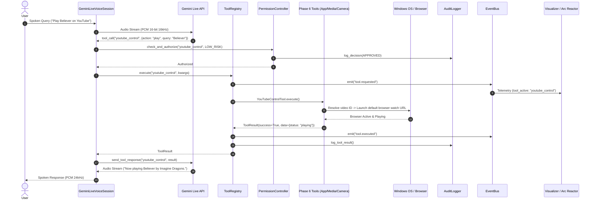
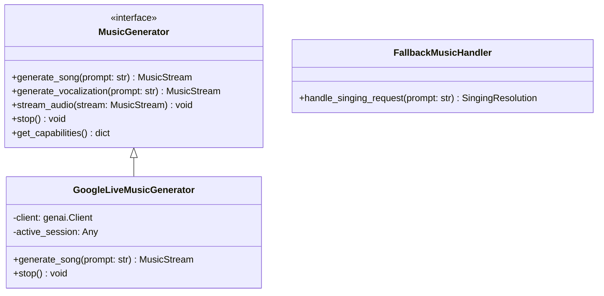

# JARVIS Phase 6: System Architecture Specification

**Author:** JARVIS Architecture Team  
**Phase:** Phase 6 — Real-World Application, Browser, Vision & Media Control  
**Date:** September 2026  
**Status:** Approved for Implementation  

---

## 1. Architectural Vision & Scope

Phase 6 addresses the real-world operational gaps of JARVIS on Windows 10/11 environments:
1. **Application Control**: Reliable, safe, non-arbitrary launching of desktop and Universal Windows Platform (UWP) apps (including Windows Camera).
2. **Browser & YouTube Media Control**: Direct video search-to-playback resolution and media playback control (play, pause, resume, stop, skip).
3. **Camera Vision System**: A strictly separated three-tier camera capability (App Launch, Frame Capture, Visual Analysis) respecting privacy constraints.
4. **Music & Singing Architecture**: A dedicated `MusicGenerator` abstraction isolating music/audio generation from the core conversational speech loop, with honest capability boundaries for vocal synthesis.
5. **Model Strategy**: Preserving `gemini-3.1-flash-live-preview` as the stable default while documenting migration paths to `gemini-3.8-live`.

### Core Architectural Invariants
* **Single Authoritative Core**: No secondary AI brains, no duplicate tool registries, no shadow state machines, and no bypassing `PermissionController`.
* **Zero Arbitrary Shell Execution**: Elimination of insecure `start "" "{app}"` shell execution patterns.
* **Deterministic Execution First**: DOM and URI-based automation take precedence over slow/costly visual computer control.
* **Complete Auditability**: Every execution traverses `PermissionController` and logs to `AuditLogger`.

---

## 2. End-to-End System Flow



---

## 3. Subsystem Architecture

### 3.1 Windows Application Control (`jarvis.tools.applications`)

#### 3.1.1 Registry of Known Safe Applications
Instead of spawning arbitrary shell commands, `LaunchApplicationTool` employs a declarative resolver:

```python
KNOWN_WINDOWS_APPS = {
    # UWP Applications (Registered Shell URI Schemes)
    "camera": {"type": "uri", "target": "microsoft.windows.camera:", "process": "WindowsCamera.exe"},
    "webcam": {"type": "uri", "target": "microsoft.windows.camera:", "process": "WindowsCamera.exe"},
    "calculator": {"type": "uri", "target": "calculator:", "process": "CalculatorApp.exe"},
    "calc": {"type": "uri", "target": "calculator:", "process": "CalculatorApp.exe"},
    "settings": {"type": "uri", "target": "ms-settings:", "process": "SystemSettings.exe"},
    "paint": {"type": "uri", "target": "ms-paint:", "process": "mspaint.exe"},
    "photos": {"type": "uri", "target": "ms-photos:", "process": "Photos.exe"},
    "maps": {"type": "uri", "target": "bingmaps:", "process": "Maps.exe"},
    
    # Win32 Desktop Applications
    "notepad": {"type": "binary", "target": "notepad.exe", "process": "notepad.exe"},
    "explorer": {"type": "binary", "target": "explorer.exe", "process": "explorer.exe"},
    "cmd": {"type": "binary", "target": "cmd.exe", "process": "cmd.exe"},
    "powershell": {"type": "binary", "target": "powershell.exe", "process": "powershell.exe"},
    "chrome": {"type": "binary", "target": "chrome.exe", "process": "chrome.exe"},
    "msedge": {"type": "binary", "target": "msedge.exe", "process": "msedge.exe"},
}
```

#### 3.1.2 Safe Launch & Verification Lifecycle
1. **Lookup**: Match requested `app_name` against `KNOWN_WINDOWS_APPS` (case-insensitive, normalized).
2. **URI Dispatch**: For UWP applications, execute `os.startfile(app_entry["target"])`.
3. **Binary Dispatch**: For Win32 binaries, locate using `shutil.which(app_entry["target"])` and launch using `asyncio.create_subprocess_exec()`.
4. **Verification**: Asynchronously poll running processes via `psutil` or check active window titles via `pygetwindow` up to a 2.5-second timeout.
5. **Security**: Reject path traversal, pipe injections, or unverified executable strings.

---

### 3.2 YouTube & Browser Media Control (`jarvis.tools.media`)

#### 3.2.1 Architecture
* **Tool Name**: `youtube_control`
* **Permission Level**: `LOW_RISK` (Level 1)
* **Supported Actions**:
  * `play`: Accepts `query`. Queries YouTube search results, extracts the canonical 11-character video ID (`/watch\?v=([a-zA-Z0-9_-]{11})`), constructs direct watch URL `https://www.youtube.com/watch?v={id}`, and launches via default OS browser.
  * `pause`: Focuses YouTube browser tab/window and transmits media key (`playpause`) or playback shortcut (`k`).
  * `resume`: Resumes active playback.
  * `stop`: Closes or pauses active YouTube playback tab.
  * `skip` / `next`: Sends `Shift+N` (YouTube next video shortcut).

#### 3.2.2 Fast Video ID Resolution Pipeline
```mermaid
flowchart TD
    A[User Query: 'Play Believer by Imagine Dragons'] --> B[Fetch https://www.youtube.com/results?search_query=...]
    B --> C[Regex Extract: /watch\?v=([a-zA-Z0-9_-]{11})]
    C --> D{Found Video ID?}
    D -- Yes --> E[Open https://www.youtube.com/watch?v=VIDEO_ID in Default Browser]
    D -- No --> F[Fallback: Open Search Results Page with Guidance]
    E --> G[Verify Window Focus & Return Result]
```

---

### 3.3 Camera Vision Subsystem (`jarvis.tools.camera`)

To protect user privacy and avoid uncontrolled background capture, Camera capabilities are segregated into three distinct tools:

```
                          ┌───────────────────────────┐
                          │   Camera Subsystem        │
                          └─────────────┬─────────────┘
                                        │
           ┌────────────────────────────┼────────────────────────────┐
           ▼                            ▼                            ▼
┌─────────────────────┐      ┌─────────────────────┐      ┌─────────────────────┐
│    open_camera      │      │capture_camera_frame │      │analyze_camera_frame │
│                     │      │                     │      │                     │
│ Launches Windows    │      │ Captures 1 frame    │      │ Captures 1 frame &  │
│ Camera App UI for   │      │ via OpenCV          │      │ queries Gemini      │
│ user viewing.       │      │ Releases device     │      │ Vision for scene    │
│ No image reading.   │      │ immediately.        │      │ analysis.           │
│ Level 1 (LOW_RISK)  │      │ Level 2 (MODERATE)  │      │ Level 2 (MODERATE)  │
└─────────────────────┘      └─────────────────────┘      └─────────────────────┘
```

#### 3.3.1 Privacy Constraints
* **Device Acquisition**: `cv2.VideoCapture(0, cv2.CAP_DSHOW)` is opened only for the duration of a single frame capture and released immediately (`cap.release()`).
* **No Disk Persistence**: Frames are processed in-memory as encoded JPEG bytes (`cv2.imencode('.jpg', frame)`) and passed to Gemini Vision. No images are saved to disk unless explicitly commanded.
* **Audit Trail**: Every camera frame capture logs an entry in `logs/audit.log` documenting timestamp and user context.

---

### 3.4 Music & Singing Architecture (`jarvis.voice.music`)

#### 3.4.1 Decoupled Abstraction


#### 3.4.2 Truth in Capabilities & Fallback Strategy
* **Singing Requests**: Gemini Live models are speech synthesizers. When a user requests singing, the system:
  1. Acknowledges the prompt honestly without faking musical audio synthesis.
  2. Generates rhythmic/poetic lyrics via Gemini.
  3. Offers the user the option to immediately play the real song or backing track on YouTube via `youtube_control`.

---

## 4. Permission & Security Matrix

| Tool Name | Action / Scope | Permission Tier | Human Approval? | Audit Logged? |
| :--- | :--- | :---: | :---: | :---: |
| `launch_application` | Safe known apps (`camera`, `calc`, `notepad`) | `LOW_RISK` (1) | No (auto-approved) | Yes |
| `launch_application` | Arbitrary custom binary path | `MODERATE` (2) | Threshold check | Yes |
| `youtube_control` | Media play/pause/resume/stop | `LOW_RISK` (1) | No (auto-approved) | Yes |
| `open_camera` | Launch Windows Camera App | `LOW_RISK` (1) | No (auto-approved) | Yes |
| `capture_camera_frame`| One-shot hardware camera capture | `MODERATE` (2) | Logged & Monitored | Yes |
| `analyze_camera_frame`| Vision analysis of camera frame | `MODERATE` (2) | Logged & Monitored | Yes |
| `music_control` | Instrumental stream start/stop | `LOW_RISK` (1) | No (auto-approved) | Yes |

---

## 5. Verification & Testing Strategy

1. **Unit Tests (`tests/test_phase6.py`)**:
   * App launch resolver (UWP URI mapping, safe binary fallback, rejection of arbitrary shell strings).
   * App launch verification logic (mocked process/window finder).
   * YouTube video ID extraction regex from HTML mock.
   * YouTube control actions (`play`, `pause`, `resume`, `stop`, `skip`).
   * Camera tools (mocked `cv2.VideoCapture` frame capture, resource cleanup verification).
   * Music generator interface and capabilities negotiation.
   * Permission tiers and audit logger verification for all new tools.
2. **Regression Verification**:
   * Run full test suite (`pytest tests/ -v`). Ensure 100% of the 92 existing tests pass with zero regressions.
