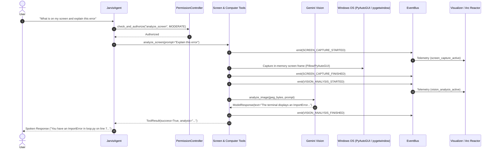

# JARVIS Phase 7: System Architecture Specification
## Perception & Intelligent Computer Control

**Author:** JARVIS Architecture Team  
**Phase:** Phase 7 — Perception & Intelligent Computer Control  
**Date:** September 2026  
**Status:** Approved for Implementation  

---

## 1. Architectural Scope & Principles

Phase 7 introduces screen perception, context awareness, and visually-grounded computer interaction while maintaining the single-brain principle:
* **One Authoritative Brain**: `JarvisAgent` is the sole decision maker. No second LLM, no duplicate tool registry, and no independent browser/computer agents.
* **Deterministic Verification**: Every computer interaction follows the observe $\rightarrow$ act $\rightarrow$ verify loop.
* **Strict Privacy by Design**: Zero unsolicited background capture, zero disk persistence by default, and zero sensitive data logging.
* **Granular Permission Gating**: All perception and interaction commands route through `PermissionController` and record to `AuditLogger`.

---

## 2. End-to-End System Sequence



---

## 3. Subsystem Breakdown

### 3.1 Screen Perception Subsystem (`jarvis.tools.screen`)

#### 3.1.1 `CaptureScreenTool` (`capture_screen`)
* **Purpose**: Captures the current display screen into memory.
* **Permission Tier**: `PermissionLevel.LOW_RISK` (1).
* **Privacy Guarantees**:
  * Captures only upon explicit call.
  * Encodes to JPEG bytes and base64 in RAM.
  * Writes to disk **only** if `save_path` is explicitly passed.
* **Output**: `{"status": "captured", "width": w, "height": h, "image_base64": "...", "format": "jpeg"}`.

#### 3.1.2 `GetActiveWindowTool` (`get_active_window`)
* **Purpose**: Inspects the current foreground desktop window.
* **Permission Tier**: `PermissionLevel.LOW_RISK` (1).
* **Output**: Window title, process name, PID, geometry (left, top, width, height), minimized/maximized status.

#### 3.1.3 `GetActiveApplicationTool` (`get_active_application`)
* **Purpose**: Identifies the foreground application and enriches it with project memory context.
* **Permission Tier**: `PermissionLevel.LOW_RISK` (1).
* **Output**:
  ```json
  {
    "application_name": "Visual Studio Code",
    "window_title": "main.py - Jarves gemini - Visual Studio Code",
    "pid": 14208,
    "project_context": {
      "project_name": "Jarves gemini",
      "current_branch": "main",
      "active_phase": "Phase 7"
    }
  }
  ```

#### 3.1.4 `AnalyzeScreenTool` (`analyze_screen`)
* **Purpose**: Captures the screen into memory and passes it to `GeminiProvider.analyze_image()` for scene understanding, OCR, or error explanation.
* **Permission Tier**: `PermissionLevel.MODERATE` (2).
* **Output**: `{"status": "analyzed", "prompt": "...", "analysis": "...", "window_context": "..."}`.

---

### 3.2 Controlled Computer Interaction Subsystem (`jarvis.tools.computer`)

All computer interaction tools feature:
1. Fail-Safe enabled (`pyautogui.FAILSAFE = True`).
2. Verification of post-action cursor position or window focus.
3. Structured output with verified status.

| Tool Name | Action | Permission Tier | Parameters | Verification Method |
| :--- | :--- | :---: | :--- | :--- |
| `mouse_move` | Move cursor | `LOW_RISK` (1) | `x: int, y: int, duration: float` | Check `pyautogui.position() == (x, y)` |
| `mouse_click` | Single click | `MODERATE` (2) | `x: int, y: int, button: str` | Check cursor coordinates and OS execution |
| `double_click`| Double click | `MODERATE` (2) | `x: int, y: int, button: str` | Check cursor coordinates and OS execution |
| `right_click` | Context menu click | `MODERATE` (2) | `x: int, y: int` | Check cursor coordinates and OS execution |
| `mouse_scroll`| Scroll wheel | `MODERATE` (2) | `clicks: int, direction: str` | Check execution completion |
| `keyboard_type` | Type text string | `MODERATE` (2) | `text: str, interval: float` | Length typed, secret detection |
| `press_key` | Single key press | `MODERATE` (2) | `key: str, presses: int` | PyAutoGUI valid key lookup |
| `keyboard_hotkey` | Key combination | `MODERATE` (2) | `keys: list[str]` | Check keys valid and executed |

---

### 3.3 Visual Grounding Subsystem (`jarvis.tools.grounding`)

#### 3.3.1 `VisualGroundingClickTool` (`visual_grounding_click`)
* **Purpose**: High-level action allowing user to say *"Click the Submit button"* or *"Click the Search field"*.
* **Permission Tier**: `PermissionLevel.MODERATE` (2).
* **Workflow**:
  1. Capture current display screen in-memory as JPEG.
  2. Query Gemini Vision with strict JSON output schema:
     ```json
     {
       "target_found": true,
       "target_label": "Submit button",
       "coordinates_normalized": [ymin, xmin, ymax, xmax],
       "confidence": 0.95
     }
     ```
  3. Validate coordinates within normalized $[0, 1000]$ range.
  4. If `target_found` is `false` or confidence is low, return structured failure `{"success": false, "reason": "target_not_confidently_identified"}` without clicking arbitrary locations.
  5. If valid, translate normalized box center to screen pixels:
     $$X = \frac{xmin + xmax}{2000} \times \text{ScreenWidth}$$
     $$Y = \frac{ymin + ymax}{2000} \times \text{ScreenHeight}$$
  6. Execute click via `pyautogui.click(X, Y)`.
  7. Wait $0.5\text{s}$ and verify action completion.
  8. Return structured result with coordinates and verification status.

---

### 3.4 Lightweight Task State Model

For complex multi-step visual interaction, JARVIS coordinates steps through a clean linear lifecycle:

```
[PENDING] ──> [CAPTURING] ──> [ANALYZING] ──> [EXECUTING] ──> [VERIFYING] ──> [COMPLETE]
      │              │              │               │               │
      └──────────────┴──────────────┴───────────────┴───────────────┴──> [FAILED / CANCELLED]
```

---

### 3.5 EventBus & Visualizer (HUD) Integration

The following new telemetry events are added to `EventType`:
* `SCREEN_CAPTURE_STARTED` (`screen.capture_started`)
* `SCREEN_CAPTURE_FINISHED` (`screen.capture_finished`)
* `VISION_ANALYSIS_STARTED` (`vision.analysis_started`)
* `VISION_ANALYSIS_FINISHED` (`vision.analysis_finished`)
* `COMPUTER_ACTION_REQUESTED` (`computer.action_requested`)
* `COMPUTER_ACTION_EXECUTED` (`computer.action_executed`)
* `COMPUTER_ACTION_VERIFIED` (`computer.action_verified`)
* `COMPUTER_ACTION_FAILED` (`computer.action_failed`)

`VisualizerAdapter` forwards these events to the HUD as `TelemetryFrameType.TASK_UPDATE` or `TelemetryFrameType.TOOL_EVENT`, providing real-time visual feedback on the Arc Reactor display during screen analysis.

---

## 4. Privacy & Security Rules

1. **Screen Capture Privacy**:
   * No background frame polling or invisible recording threads.
   * Captured images remain strictly in memory as binary JPEG payloads and are cleared upon turn completion.
   * `save_path` is disallowed unless user explicitly commands saving.
2. **Audit Logging**:
   * Tool name, arguments, coordinates, duration, and success status are recorded.
   * Base64 image payloads are **redacted** from audit logs.
   * Sensitive key names or credentials typed via keyboard are masked via `_SECRET_PATTERN`.
3. **No LLM Bypass**:
   * All computer actions pass through `ToolRegistry.execute()` and `PermissionController`.

---

## 5. Verification & Testing Strategy

1. **Unit Tests (`tests/test_phase7.py`)**:
   * Screen capture (resolution, in-memory bytes, no disk write).
   * Active window and application detection (title, process, geometry, project memory enrichment).
   * Computer interaction tools (click, double click, right click, scroll, press key, type, hotkey).
   * Visual grounding (target found $\rightarrow$ coordinate translation $\rightarrow$ click, target not found $\rightarrow$ rejection).
   * Verification of action outcomes and failure detection.
   * Telemetry event emissions on `EventBus`.
   * Security classification and audit redaction.
2. **Full Regression Suite**:
   * Run `python -m pytest tests/ -v` to ensure all 118 existing tests from Phases 1–6 pass without regression.
