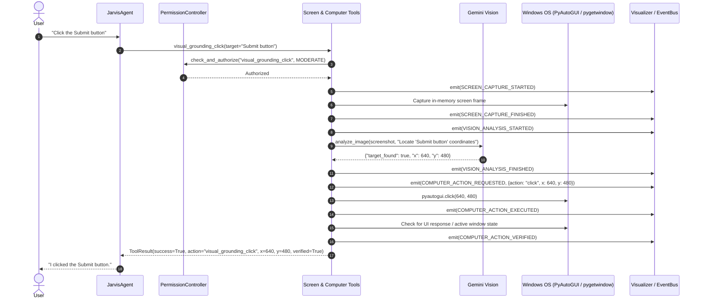

# JARVIS Phase 7: Technical Audit & Capabilities Research
## Perception & Intelligent Computer Control

**Author:** JARVIS Architecture Team  
**Phase:** Phase 7 — Perception & Intelligent Computer Control  
**Date:** September 2026  
**Status:** Audit & Research Gate Complete  

---

## 1. Executive Summary & Objective

Phase 7 introduces context awareness and intelligent, visual computer control to JARVIS while strictly upholding the core architectural invariant:
**There is exactly ONE JARVIS brain.**
All actions, perceptions, and tool decisions route exclusively through `JarvisAgent` $\rightarrow$ `GeminiProvider` / `GeminiLiveVoiceSession` $\rightarrow$ `ToolRegistry` $\rightarrow$ `PermissionController` $\rightarrow$ `AuditLogger` $\rightarrow$ `EventBus`.

This document performs an exhaustive audit of Phases 1–6 components, establishes what computer control functionality exists versus what is needed, and investigates official Google Gemini vision, multimodal reasoning, and computer-use capabilities.

All research findings below are categorized into **FACT**, **IMPLEMENTATION OPTION**, **LIMITATION**, and **ASSUMPTION**.

---

## 2. Existing Phase 1–6 Codebase Audit

### 2.1 Core Agent & Models (`jarvis.core.agent`, `jarvis.models.gemini`)
* **FACT**: `JarvisAgent` coordinates reasoning, state, memory injection, and tool loops.
* **FACT**: `GeminiProvider.analyze_image()` is already implemented in `jarvis/models/gemini.py`:
  ```python
  contents = [prompt, types.Part.from_bytes(data=image_bytes, mime_type=mime_type)]
  response = await self.client.aio.models.generate_content(model=target_model, contents=contents, config=config)
  ```
  It accepts raw image bytes and returns a standardized `ModelResponse`.
* **FACT**: `GeminiLiveVoiceSession` handles bidirectional function calls over WebSocket (`types.LiveConnectConfig(tools=...)`) and sends tool responses back via `session.send_tool_response()`.

### 2.2 Security, Permissions & Audit (`jarvis.security.permissions`)
* **FACT**: `PermissionController` enforces a 5-tier security model:
  * `SAFE` (0) & `LOW_RISK` (1): Auto-approved (inspections, safe queries, graceful window close).
  * `MODERATE` (2): Mouse/keyboard input, camera capture, file edits (monitored/auto-approved if below threshold).
  * `HIGH_RISK` (3) & `CRITICAL` (4): Mandatory human confirmation (force terminate process, arbitrary shell execution, system deletions).
* **FACT**: `AuditLogger` records all tool executions, sanitized arguments (secrets redacted via regex), execution duration, and outcomes to `logs/audit.log`.

### 2.3 EventBus, State Machine & HUD Telemetry (`jarvis.events`, `jarvis.visualizer`)
* **FACT**: `EventBus` broadcasts system events asynchronously.
* **FACT**: `StateMachine` maintains agent lifecycle states (`IDLE`, `THINKING`, `TOOL_EXECUTION`, `WAITING_FOR_PERMISSION`, etc.).
* **FACT**: `VisualizerAdapter` broadcasts state and tool telemetry to WebSocket clients (Arc Reactor HUD) at 60 FPS.

### 2.4 Existing Computer-Control & Browser Tools Audit
* **FACT**: The existing `jarvis/tools/computer.py` module defines:
  * `MouseMoveTool` (`mouse_move`): moves cursor to $(x, y)$.
  * `MouseClickTool` (`mouse_click`): clicks at $(x, y)$ or current position with left/right/middle button.
  * `KeyboardTypeTool` (`keyboard_type`): writes text with key intervals.
  * `KeyboardHotkeyTool` (`keyboard_hotkey`): sends hotkeys (e.g. `['ctrl', 'c']`).
  * `CaptureScreenshotTool` (`capture_screenshot`): captures a screenshot and writes it to disk (`logs/screenshot.png`).
* **LIMITATION**: The existing `CaptureScreenshotTool` persists screenshots to disk by default, violating Phase 7 privacy requirements (*"Do not persist screenshots unless explicitly requested"*).
* **FACT**: The following essential computer-control capabilities are currently missing:
  * `double_click`
  * `right_click`
  * `press_key` (single key press: `enter`, `escape`, `tab`, `backspace`, arrow keys)
  * `scroll` (vertical and horizontal mouse wheel scrolling)
  * `get_active_window` (inspects foreground window title, process, dimensions, state)
  * `get_active_application` (identifies active application and connects with project memory)
  * `capture_screen` (in-memory capture returning bytes/base64 without disk persistence)
  * `analyze_screen` (captures screen in-memory and queries Gemini Vision for context or error analysis)
  * `visual_grounding_click` (locates UI elements visually via Gemini coordinates and clicks them with verification)

### 2.5 Existing Memory Subsystem (`jarvis.memory`)
* **FACT**: `MemoryManager` contains `self.project` (`ProjectMemory`), which tracks project name, workspace path, Git branch, clean/dirty status, and active phases.
* **FACT**: When a user asks *"What am I currently working on?"*, combining the foreground window title (e.g., `main.py - Jarves gemini - Visual Studio Code`) with `ProjectMemory` yields grounded, truthful context without hallucination.

---

## 3. Official Google Gemini Documentation & Capabilities Audit

### 3.1 Gemini Multimodal Vision & Spatial Grounding
* **FACT**: Official Google GenAI SDK (`google-genai>=2.8.0`) models (`gemini-2.5-flash`, `gemini-2.5-pro`, `gemini-3.8-flash`) support high-resolution image analysis and 2D spatial coordinate grounding.
* **FACT**: In Gemini's spatial grounding format, bounding boxes are returned as normalized coordinates $[y_{\min}, x_{\min}, y_{\max}, x_{\max}]$ on a scale of $[0, 1000]$.
* **FACT**: Converting normalized coordinates to absolute screen pixels is deterministic:
  $$\text{Target } X = \frac{x_{\min} + x_{\max}}{2000} \times \text{ScreenWidth}$$
  $$\text{Target } Y = \frac{y_{\min} + y_{\max}}{2000} \times \text{ScreenHeight}$$
* **FACT**: If Gemini cannot find a requested UI target, it responds with explicit rejection rather than hallucinating coordinates when instructed with a strict prompt contract.

### 3.2 Gemini Computer Use
* **FACT**: Google Cloud Vertex AI provides a specialized "Computer Use" agent model (`gemini-2.5-computer-use`), which operates in a loop of screenshot $\rightarrow$ coordinate prediction $\rightarrow$ action execution.
* **LIMITATION**: The Vertex AI Computer Use model requires continuous screenshot uploads, dedicated Vertex endpoints, and incurs 1.5–3.5s latency per step.
* **IMPLEMENTATION OPTION**: In the local JARVIS environment, deterministic DOM/OS automation (Phase 6) and visual grounding via multimodal Gemini Vision (`analyze_image`) provide superior speed ($<300\text{ms}$ for OS/DOM, $\approx 1.2\text{s}$ for Vision), full offline safety, and zero external agent dependencies.
* **RECOMMENDATION**: Implement visual grounding using `GeminiProvider.analyze_image()` with standardized coordinate extraction, reserving mouse/keyboard execution strictly under `PermissionController`.

### 3.3 Gemini Live Multimodal WebSocket Input
* **FACT**: The Multimodal Live API supports real-time image chunks via `types.LiveClientRealtimeInput(media_chunks=[types.Blob(data=..., mime_type="image/jpeg")])`.
* **LIMITATION**: Continuously streaming high-resolution desktop frames over WebSocket consumes immense bandwidth and token quota (~258 tokens per frame at 1 FPS = ~15,000 tokens/minute), which easily exhausts rate limits.
* **FACT**: Screen perception is inherently on-demand. When the user asks *"What's on my screen?"* or *"Click the Submit button"*, a single high-resolution screenshot captured in-memory satisfies the intent with zero background overhead.

---

## 4. Privacy, Security & Sensitive Data Architecture

### 4.1 Strict Privacy Invariants
1. **Zero Unsolicited Background Capture**: The screen is captured **only** upon explicit user request (e.g., *"What is on my screen?"*) or during an authorized computer control action (e.g., visual grounding).
2. **Zero Disk Persistence by Default**: Screenshots are held as transient in-memory JPEG bytes and garbage collected immediately after API dispatch. Disk persistence occurs only if the user explicitly specifies a destination file.
3. **No External Leakage**: Screenshots are transmitted exclusively to the user-configured Google Gemini endpoint via official SDK HTTPS requests.
4. **Secret & Sensitive Data Protection**:
   * Text typed via `keyboard_type` is sanitized: sensitive fields (passwords, tokens) are classified under `HIGH_RISK` and redacted in audit logs.
   * `AuditLogger` records tool names, coordinate targets, execution time, and success/failure, but **never** stores base64 image blobs in `logs/audit.log`.

### 4.2 Permission Classification Matrix for Phase 7
* **`LOW_RISK` (Level 1)**:
  * `get_active_window`: passive inspection of title/process.
  * `get_active_application`: passive inspection combined with project memory.
  * `capture_screen`: in-memory capture upon explicit command.
* **`MODERATE` (Level 2)**:
  * `analyze_screen`: vision model scene analysis.
  * `mouse_move`, `mouse_click`, `double_click`, `right_click`, `scroll`.
  * `keyboard_type` (non-sensitive text), `press_key`, `keyboard_hotkey`.
  * `visual_grounding_click`: visual target localization and click execution.
* **`HIGH_RISK` (Level 3)**:
  * Typing sensitive credentials (passwords, auth tokens).
  * System-level destructive actions or external transaction submissions.

---

## 5. Visual Grounding & Action Verification Architecture



---

## 6. Audit & Research Categorization Summary

### FACT
* `GeminiProvider.analyze_image()` is fully functional and ready for multimodal screen analysis.
* `pygetwindow.getActiveWindow()` reliably provides the active window title and coordinates on Windows.
* `psutil` allows resolving the active process executable name and PID from window handles.
* PyAutoGUI provides reliable mouse/keyboard automation with `FAILSAFE = True` enabled.

### IMPLEMENTATION OPTION
* **Option A**: Rebuild `CaptureScreenshotTool` to support transient in-memory capture without disk persistence, and add `CaptureScreenTool` as the primary perception primitive.
* **Option B**: Consolidate mouse actions into dedicated, verified tools (`mouse_click`, `double_click`, `right_click`, `scroll`, `press_key`).
* **Option C**: Implement `VisualGroundingTool` using structured JSON prompting with `GeminiProvider.analyze_image()`.

### LIMITATION
* Continuous background desktop video streaming over WebSocket is not bandwidth-viable or token-efficient.
* Screen perception cannot see contents obscured by other windows unless the target window is brought to the foreground.

### ASSUMPTION
* The user's primary display is the active monitor for coordinate calculations when multi-monitor setups exist.

---

**Audit & Research Gate Complete. Ready for architecture specification and implementation.**
