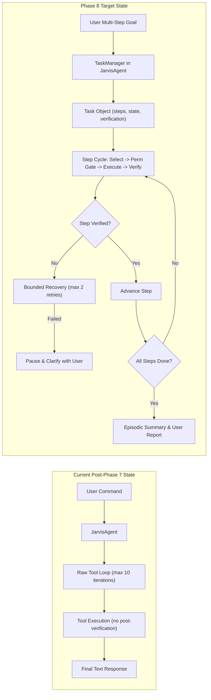

# Phase 8 — Task & Workflow Intelligence: Research & Grounding

## 1. Executive Summary & Codebase Audit

Phase 8 elevates JARVIS from executing single atomic commands into executing safe, goal-directed **multi-step tasks and workflows** (e.g. *"Open Chrome, search for Python documentation, open the official result, read it, and summarize the key points"* or *"Look at the error on my screen, identify the relevant project file, inspect it, and explain what is wrong"*).

Crucially, this evolution **does not introduce a secondary agent, a separate planner LLM, recursive agents, or AGI aspirations**. In accordance with the project's critical architectural invariant:
- **`JarvisAgent` remains the single authoritative brain.**
- Gemini remains the exclusive reasoning engine.
- `ToolRegistry`, `PermissionController`, `EventBus`, `StateMachine`, `MemoryManager`, and `AuditLogger` remain the single authoritative controllers.

The task system is an **orchestration and state tracking layer**, not another autonomous brain.

---

## 2. Existing Codebase Audit: Reusable Subsystems vs Gaps

A comprehensive review of the Post-Phase 7 implementation confirms that significant building blocks are already operational and must be reused rather than reinvented:

| Subsystem | Existing Implementation Status | Capabilities Directly Reusable in Phase 8 | Gaps to Address in Phase 8 |
| :--- | :--- | :--- | :--- |
| **`JarvisAgent`** (`jarvis/core/agent.py`) | Single authoritative reasoning orchestrator. Runs `_run_gemini_tool_loop` with `max_iterations = 10`. | Multi-turn chat session with Gemini, tool call dispatching, tool response passing. | Currently executes raw tool turns without explicit task decomposition, step tracking, or step-level rollback. |
| **`WorkingMemory` & `TaskState`** (`jarvis/memory/working.py`) | Ephemeral scratchpad holding `TaskState` (`objective`, `current_step`, `total_steps`, `variables`, `tool_results`, `decisions`, `modified_files`). | In-memory task context and variable tracking already instantiated. | Not yet integrated into active step progression, verification states, or cancellation flags. |
| **`StateMachine`** (`jarvis/core/state.py`) | 8 deterministic operational states (`IDLE`, `LISTENING`, `THINKING`, `TOOL_EXECUTION`, `WAITING_FOR_PERMISSION`, `SPEAKING`, `INTERRUPTED`, `ERROR`, `CANCELLED`). | Centralized agent state transitions and validation. | Operational agent states are well-defined; task-level workflow states (`PENDING`, `EXECUTING`, `VERIFYING`, `PAUSED`, `COMPLETED`, `FAILED`) should be tracked in a dedicated `Task` model rather than polluting general agent operational states. |
| **`EventBus`** (`jarvis/events.py`) | Async pub/sub event bus with typed catalog. | Event broadcasting to HUD, loggers, and test observers. | Needs typed `TASK_*` events (`TASK_CREATED`, `TASK_STEP_STARTED`, `TASK_VERIFYING`, etc.) for HUD telemetry. |
| **`ToolRegistry`** (`jarvis/tools/registry.py`) | 25 registered tools across Filesystem, Terminal, Apps, Computer, Browser, Screen, Grounding, Camera, Media. | Deterministic tool lookup, argument validation, execution pipeline. | Fully reusable as-is. Tools must remain standard callable actions. |
| **`PermissionController`** (`jarvis/security/permissions.py`) | 5-tier deterministic authorization with async human approval callbacks. | Threshold gating (Level 3/4 require approval), interactive CLI & HUD approval. | Need task execution to pause on `WAITING_FOR_PERMISSION` and cleanly resume or abort based on human decision without corrupting task state. |
| **`AuditLogger`** (`jarvis/security/permissions.py`) | Append-only ledger to `logs/audit.log` with secret and payload sanitization. | Redacts keys, tokens, passwords, and base64 image data automatically. | Fully reusable as-is. Task ID and step index should be attached to metadata. |
| **`GeminiLiveVoiceSession`** (`jarvis/voice/live_session.py`) | 24kHz PCM bi-directional WebSockets with barge-in interruption. | Real-time voice interaction, tool call execution over live session. | Live session already receives `tool_call_cancellation` from Google server on barge-in; task system must coordinate with voice interruption so saying "Stop" cancels active tasks. |
| **Screen Perception & Verification** (`jarvis/tools/screen.py`, `grounding.py`) | `capture_screen` (in-memory JPEG), `get_active_window` (< 0.1ms), `visual_grounding_click`. | Post-action verification: inspect window title change, verify coordinate click, analyze screen state. | Verification is currently ad-hoc; Phase 8 requires explicit step verification routines. |
| **Visualizer / Web HUD** (`jarvis/visualizer/`) | FastAPI + Uvicorn server, `/ws/telemetry` WebSocket, reactive UI. | Real-time event broadcasting and permission approval dialogs. | HUD should display current task progress (Objective, Step X of Y, Status, Verification indicator) without executing tools. |

---

## 3. Phase 8A: Official Google Gemini Tool-Calling Research

Research conducted on official Google Gemini documentation (`ai.google.dev`) and the `google-genai` Python SDK (v2.8.0) establishes the authoritative foundation for multi-step function calling, context preservation, and live tool interaction.

### 3.1 Function Calling & Multi-Turn Interaction

#### Official SDK Pattern
In the official `google-genai` SDK, function calling follows a structured request-response cycle:
1. **Declaration**: Tools are declared via `types.Tool(function_declarations=[...])` and passed to `generate_content` or `chats.create`.
2. **Model Invocation**: The model analyzes user input and either produces text or emits one or more `types.FunctionCall` objects (with `name`, `args`, and optionally `id`).
3. **Client Execution**: The client executes the matching local Python tool.
4. **Function Response**: The client provides the result via `types.Part.from_function_response(name=..., response={...})` (or `types.FunctionResponse`).
5. **Continuation**: The model consumes the tool response and either issues subsequent tool calls (sequential multi-turn loop) or synthesizes the final response.

#### Parallel Tool Calling
Gemini 2.0 Flash / 2.5 Flash models support parallel function calling. The model may emit multiple `FunctionCall` objects in a single turn (e.g. calling `get_active_window` and `capture_screen` simultaneously).
- In JARVIS, `JarvisAgent._run_gemini_tool_loop` already iterates over `response.tool_calls` and collects `tool_response_parts` for the next turn.

#### Function Calling Modes (`FunctionCallingConfig`)
Google Gemini provides explicit controls over function calling behavior:
- `Mode.AUTO` (Default): The model decides autonomously between returning text or generating tool calls.
- `Mode.ANY`: Constrains the model to **always** predict a function call. Can be restricted to specific allowed functions via `allowed_function_names`.
- `Mode.NONE`: Disables function calling completely without modifying tool definitions.
- `Mode.VALIDATED`: Constrains the model to adhere strictly to JSON schemas and tool definitions.

### 3.2 Gemini Live API Function Calling & Interruption

In the Gemini Multimodal Live API (`client.aio.live.connect`):
- Tool calls arrive over the bi-directional WebSocket stream as `msg.tool_call.function_calls`.
- Client must respond with `session.send_tool_response(function_responses=[types.FunctionResponse(...)])`.
- **Interruption & Cancellation**: When the user interrupts via voice (barge-in) while a tool is executing or in flight, the Gemini Live server dispatches `msg.tool_call_cancellation` containing the IDs of cancelled tool calls.
- In `jarvis/voice/live_session.py`, line 393 already detects `msg.tool_call_cancellation`. In Phase 8, this cancellation signal must cleanly propagate to abort in-flight task steps.

### 3.3 Context Management Across Multi-Step Tasks

In long-running tasks, sending entire historical tool outputs (e.g. large webpage texts, terminal logs, or window hierarchies) across multiple turns can exhaust context limits or cause token bloat:
- **Pruning / Summarization**: Raw tool outputs must be truncated or summarized in working memory.
- `TerminalExecuteTool` already caps stdout to 4,000 characters.
- `ReadWebpageTool` already caps readable text to 5,000 characters.
- Screen perception tools keep base64 image blobs out of conversational chat text, passing textual descriptions or structured coordinates back to the chat history.

### 3.4 Structured Outputs vs Natural Tool Calling

Gemini 2.0 / 2.5 supports structured outputs (`response_mime_type="application/json"` and `response_schema=PydanticModel`):
- Structured output is optimal for static decomposition (e.g. generating an initial list of steps).
- Tool calling (`FunctionCallingConfig: AUTO`) is optimal for reactive, dynamic step-by-step execution where the result of Step 1 (e.g. what window opened) determines Step 2.

---

## 4. Technical Distinction: Fact vs Option vs Limitation vs Assumption

To ensure engineering rigor, all technical elements are categorized:

### 4.1 FACTS (Verified by Official Docs & Working Codebase)
1. **[FACT]** Google Gemini 2.0 / 2.5 models natively support multi-turn function calling where the model receives tool responses and determines next actions.
2. **[FACT]** The official `google-genai` SDK supports both single-call generation (`client.aio.models.generate_content`) and multi-turn chat sessions (`client.aio.chats.create`).
3. **[FACT]** Gemini Live API supports tool execution over WebSockets and emits `tool_call_cancellation` when barge-in occurs.
4. **[FACT]** JARVIS currently possesses 25 working tools across desktop, browser, terminal, filesystem, camera, media, and screen perception.
5. **[FACT]** `pygetwindow` active window lookup on Windows AMD64 executes in ~0.01 ms, and in-memory screen grab takes ~32 ms.

### 4.2 IMPLEMENTATION OPTIONS (Design Choices for Phase 8)
1. **[OPTION A - Pure LLM Step Chaining]**: Rely entirely on Gemini's free-form chat session to issue sequential tool calls until it decides the goal is finished.
   - *Pros*: Simple, no extra state machine code.
   - *Cons*: Opaque progress, weak rollback, cannot pause for human confirmation cleanly across turns, prone to wandering or infinite loops.
2. **[OPTION B - Rigid Static Workflow Compiler]**: Prompt Gemini once to generate a static JSON array of 5 steps, then execute them sequentially in Python.
   - *Pros*: Highly predictable step list.
   - *Cons*: Extremely brittle. Real desktop/browser automation is non-deterministic (e.g., search results vary, dialog popups appear, pages load slowly). Static plans break on the first unexpected UI state.
3. **[OPTION C - Dynamic State-Tracked Hybrid (RECOMMENDED)]**:
   - A lightweight `TaskManager` in `JarvisAgent` maintains an explicit `Task` object (`task_id`, `goal`, `steps`, `current_step_index`, `status`, `retry_count`).
   - Gemini decomposes the goal into an initial outline of intent.
   - Execution proceeds step-by-step through the authoritative `JarvisAgent` loop:
     1. Gemini decides next tool call based on current goal + working memory + previous step result.
     2. Tool executes through `ToolRegistry` and `PermissionController`.
     3. An explicit **Verification Phase** validates that the step accomplished its objective (checking window title, URL, screen presence, or exit code).
     4. `Task` state is updated and emitted to `EventBus` for HUD display.
     5. If a step fails, bounded retry or user clarification is triggered.

### 4.3 LIMITATIONS (Known System & Model Constraints)
1. **[LIMITATION]** `mouse_click()` and `keyboard_type()` cannot natively know if the target application accepted the input without external sensory inspection (e.g. checking active window title or grabbing a screen frame).
2. **[LIMITATION]** Webpage DOM changes and asynchronous JavaScript rendering can cause race conditions if browser actions do not wait for navigation/elements.
3. **[LIMITATION]** Token context windows are finite; storing full raw webpage HTML or full terminal streams across 10 sequential steps will degrade model attention and increase latency.
4. **[LIMITATION]** High-risk tool calls (`PermissionLevel.HIGH_RISK`, e.g. `terminate_process` or `terminal_execute`) must pause execution for human approval; automated execution cannot bypass this.

### 4.4 ASSUMPTIONS (Explicit Engineering Premises)
1. **[ASSUMPTION]** Most desktop multi-step user tasks require between 2 and 6 atomic tool calls. Tasks exceeding 10 steps are either runaway loops or overly broad goals that should be decomposed.
2. **[ASSUMPTION]** If a step fails verification twice, repeating the identical tool call a third time has near-zero probability of success without altering parameters or asking the user.
3. **[ASSUMPTION]** The user can issue a cancellation command ("Stop", "Cancel") at any time via text or voice, and JARVIS must halt within < 500 ms without leaving background processes hung.
4. **[ASSUMPTION]** Web content and screen text must be treated as **untrusted data** and never parsed as system persona instructions.

---

## 5. Architectural Gap Analysis: Phase 7 Baseline to Phase 8 Target

---

## 6. Summary of Phase 8 Research Conclusions

1. **Keep `JarvisAgent` as Single Brain**: Do not create a second planner agent. Orchestrate tasks via a lightweight `TaskManager` class integrated into `JarvisAgent`.
2. **Embrace Option C (Hybrid Dynamic Execution)**: Formulate the workflow with structured step tracking while allowing Gemini to dynamically select and adapt tools based on intermediate verification results.
3. **Mandatory Post-Step Verification**: Every computer and browser action must attempt a lightweight sensory verification (window title, screen check, process check, or result inspection).
4. **Fail-Closed & Bounded**: Maximum 10 tool calls per task, maximum 2 retries per step, maximum 3-minute overall task duration, strict cancellation hooks on "Stop".
5. **HUD Observability**: Emit standardized `TASK_*` events over `EventBus` so the Web HUD visualizes live task progress and step verification status in real time.
